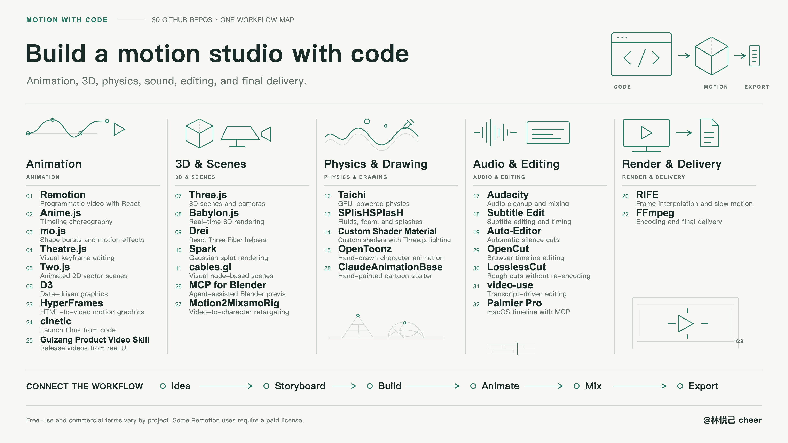

<h1>Awesome Motion & Animation</h1>

32 GitHub projects for animation, 3D, physics, audio, editing, and delivery.

   

<a href="#animation">Explore the collection</a> · <a href="CONTRIBUTING.md">Suggest a resource</a>

A curated collection for developers, motion designers, and creative coders. Find tools by production stage, follow their official repositories, and build a workflow around the piece you want to make.

This collection includes open-source projects and source-available software with custom terms. Free-use eligibility and commercial terms depend on each upstream license.

## 📑 Menu

- [Overview](#overview)
- [Getting started](#getting-started)
- [Workflow](#workflow)
- [Animation & Choreography](#animation)
- [3D & Scenes](#scenes)
- [Physics & Drawing](#physics)
- [Audio & Editing](#audio)
- [Render & Delivery](#delivery)
- [Infographic](#infographic)
- [Licensing](#licensing)
- [Contributing](#contributing)
- [Acknowledgements](#acknowledgements)

## 🧭 Overview
| Category | Projects |
| --- | ---: |
| [Animation & Choreography](#animation) | 9 |
| [3D & Scenes](#scenes) | 7 |
| [Physics & Drawing](#physics) | 5 |
| [Audio & Editing](#audio) | 8 |
| [Render & Delivery](#delivery) | 3 |

## ⚡ Getting started

1. **Choose the output.** Web motion, programmatic video, 3D scenes, and hand-drawn animation call for different starting points.
2. **Pick one core tool.** Explore React video with Remotion, build a 3D scene with Three.js or Babylon.js, or draw animation with OpenToonz.
3. **Add the stages you need.** Bring in physics, voiceovers, subtitles, and mixing as your project requires.
4. **Follow upstream setup and export instructions.** Dependencies, supported platforms, and hardware needs differ between tools.

Use this collection for discovery and tool selection. Choose the pieces you need; there is no requirement to install the entire list.

Start with the task you need to do:

- **Animate and render with HTML:** [HyperFrames](#project-23).
- **Make a product video:** [cinetic](#project-24) or [Guizang Product Video Skill](#project-25).
- **Rough-cut footage:** [LosslessCut](#project-30) for source-quality selects or [video-use](#project-31) for transcript-based edits.

## 🛠️ Workflow

**Idea → Storyboard → Build → Animate → Mix → Export**

The categories below show where tools can fit into production. Specific combinations depend on formats, dependencies, and your working environment.

## 🎞️ Animation & Choreography

Timelines, keyframes, vector scenes, and data-driven graphics.

### 01 · [Remotion](https://github.com/remotion-dev/remotion)

Remotion renders React compositions frame by frame. Use React props to vary text, imagery, and other inputs, then preview the result in Studio before rendering a video.

**In production** — Build a reusable product demo and render a separate cut for each feature or language.

[Upstream guide](https://www.remotion.dev/docs/) · **License** [Remotion custom license](https://github.com/remotion-dev/remotion/blob/main/LICENSE.md)

Free use is limited by the upstream eligibility rules; a Company License is required for other organizations.

### 02 · [Anime.js](https://github.com/juliangarnier/anime)

Anime.js animates DOM elements, SVG, and JavaScript objects. Its timelines let you overlap or sequence effects, with easing and stagger controls for groups of elements.

**In production** — Build a title reveal where the headline, accents, and supporting text enter on different beats.

[Upstream guide](https://animejs.com/documentation/) · **License** [MIT](https://github.com/juliangarnier/anime/blob/master/LICENSE.md)

### 03 · [mo.js](https://github.com/mojs/mojs)

mo.js is a JavaScript toolkit for motion graphics built from shapes, bursts, and tweens. Combine those primitives to layer short accents over a web scene.

**In production** — Add a particle burst to a logo reveal or a confirmation moment in a product demo.

[Upstream guide](https://mojs.github.io/api/) · **License** [MIT](https://github.com/mojs/mojs/blob/main/LICENSE.md)

### 04 · [Theatre.js](https://github.com/theatre-js/theatre)

Theatre.js adds a visual timeline to a scene built in JavaScript. Its Studio records keyframes for exposed properties such as camera position, object transforms, and material values.

**In production** — Tune the timing and framing of a Three.js product fly-through by adjusting keyframes in the editor.

[Upstream guide](https://www.theatrejs.com/docs/latest/) · **License** [Apache-2.0 (core) / AGPL-3.0 (studio)](https://github.com/theatre-js/theatre#license)

The core runtime and visual studio use different licenses; check the component you use.

### 05 · [Two.js](https://github.com/jonobr1/two.js)

Two.js provides a 2D scene graph with paths, shapes, text, and groups. The same drawing API works with SVG, Canvas, or WebGL, and an update loop lets you animate scene properties.

**In production** — Animate icons, line illustrations, or callouts for an explainer.

[Upstream guide](https://two.js.org/docs/two/) · **License** [MIT](https://github.com/jonobr1/two.js/blob/dev/LICENSE)

### 06 · [D3](https://github.com/d3/d3)

D3 maps data values to visual properties with scales, axes, and shape generators. Data joins and transitions can animate changes as values arrive, move, or disappear.

**In production** — Animate a launch metric chart or show how rankings change across a sequence of dates.

[Upstream guide](https://d3js.org/getting-started) · **License** [ISC](https://github.com/d3/d3/blob/main/LICENSE)

### 23 · [HyperFrames](https://github.com/heygen-com/hyperframes)

HyperFrames turns HTML, CSS, media, and seekable animation into video. Its CLI can preview a composition and render it to MP4.

**In production** — Render a title card, caption treatment, or launch animation using browser layout and GSAP timelines.

[Upstream guide](https://hyperframes.heygen.com/quickstart) · **License** [Apache-2.0](https://github.com/heygen-com/hyperframes/blob/main/LICENSE)

### 24 · [cinetic](https://github.com/Leonxlnx/cinetic)

cinetic gives coding agents a workflow for writing, designing, and rendering product launch or update films. It includes treatments for animated type and product UI and runs with Remotion or HyperFrames.

**In production** — Turn a short product brief into a release trailer with moving type and a staged interface walkthrough.

[Upstream guide](https://github.com/Leonxlnx/cinetic/blob/main/docs/setup.md) · **License** [MIT](https://github.com/Leonxlnx/cinetic/blob/main/LICENSE)

Remotion, the default renderer, has [separate licensing terms](https://github.com/remotion-dev/remotion/blob/main/LICENSE.md).

### 25 · [Guizang Product Video Skill](https://github.com/op7418/guizang-product-video-skill)

Guizang Product Video Skill guides an agent through storyboarding, adapting real product components for video, and building motion and sound around each feature. The workflow uses the product’s own design language.

**In production** — Turn a software changelog into a short video that demonstrates updated features using the actual interface.

[Upstream guide](https://github.com/op7418/guizang-product-video-skill/blob/main/SKILL.md) · **License** [AGPL-3.0](https://github.com/op7418/guizang-product-video-skill/blob/main/LICENSE)

The bundled CodePilot fallback assets retain [Business Source License 1.1 terms](https://github.com/op7418/guizang-product-video-skill/blob/main/assets/fallback/LICENSE.CodePilot).

## 🧊 3D & Scenes

Build spatial scenes, control cameras, and explore different rendering approaches.

### 07 · [Three.js](https://github.com/mrdoob/three.js)

Three.js provides JavaScript building blocks for browser-based 3D, including cameras, lighting, materials, and model loaders. Set up a scene and drive its objects or camera with code.

**In production** — Stage a product turntable or a camera move through a glTF model for a product video.

[Upstream guide](https://threejs.org/manual/) · **License** [MIT](https://github.com/mrdoob/three.js/blob/dev/LICENSE)

### 08 · [Babylon.js](https://github.com/BabylonJS/Babylon.js)

Babylon.js is a real-time 3D engine with a scene graph, animation, and physically based materials. Its browser Inspector lets you inspect and tune a running scene.

**In production** — Prototype a product scene with animated parts, then review lighting and materials before recording it.

[Upstream guide](https://doc.babylonjs.com/) · **License** [Apache-2.0](https://github.com/BabylonJS/Babylon.js/blob/master/license.md)

### 09 · [Drei](https://github.com/pmndrs/drei)

Drei supplies reusable React Three Fiber components for common 3D tasks. Helpers for cameras, environments, text, and glTF loading handle much of the scene setup.

**In production** — Set up a React 3D product shot with an environment light and camera controls.

[Upstream guide](https://drei.docs.pmnd.rs/) · **License** [MIT](https://github.com/pmndrs/drei/blob/master/LICENSE)

### 10 · [Spark](https://github.com/sparkjsdev/spark)

Spark renders 3D Gaussian splats inside Three.js and supports formats such as PLY and SPZ. A scene can combine splats with mesh objects and transform them together.

**In production** — Use a scanned location as a backdrop and add 3D titles or mesh props for a camera move.

[Upstream guide](https://sparkjs.dev/docs/) · **License** [MIT](https://github.com/sparkjsdev/spark/blob/main/LICENSE)

### 11 · [cables.gl](https://github.com/cables-gl/cables_electron)

The standalone cables.gl editor lets you connect visual nodes into patches on a desktop. Patches route data between operations that control graphics and animation.

**In production** — Build a looping abstract background by connecting geometry, transforms, and timing nodes.

[Upstream guide](https://cables.gl/standalone) · **License** [MIT](https://github.com/cables-gl/cables_electron/blob/develop/LICENCE)

### 26 · [MCP for Blender](https://github.com/ahujasid/mcp-for-blender)

MCP for Blender connects an MCP client to a Blender add-on that can inspect and modify a scene. The agent can arrange objects and cameras and request viewport or camera views for review.

**In production** — Block out a sequence and compare alternate camera angles before adding detailed models or lighting.

[Upstream guide](https://github.com/ahujasid/mcp-for-blender#quickstart) · **License** [MIT](https://github.com/ahujasid/mcp-for-blender/blob/main/LICENSE)

### 27 · [Motion2MixamoRig](https://github.com/MaxLiu22/Motion2MixamoRig)

Motion2MixamoRig estimates body motion from video, then retargets it to a Mixamo rig. Its export can be imported into Blender as an animated character.

**In production** — Start a 3D performance from a filmed movement reference and refine the result in Blender.

[Upstream guide](https://github.com/MaxLiu22/Motion2MixamoRig/blob/main/docs/user-guide.md) · **License** [Apache-2.0 (code)](https://github.com/MaxLiu22/Motion2MixamoRig/blob/main/LICENSE)

Downloaded models, weights, and character assets have [separate terms](https://github.com/MaxLiu22/Motion2MixamoRig#license); the default SMPL-X license limits commercial use.

## 🌊 Physics & Drawing

Simulate physical motion, write materials, and animate hand-drawn characters.

### 12 · [Taichi](https://github.com/taichi-dev/taichi)

Taichi adds parallel kernels and data structures to Python for numerical and graphics workloads. Simulation code can target a CPU or a supported GPU backend.

**In production** — Prototype a particle or cloth effect and tune how it moves before using it in a shot.

[Upstream guide](https://docs.taichi-lang.org/) · **License** [Apache-2.0](https://github.com/taichi-dev/taichi/blob/master/LICENSE)

### 13 · [SPlisHSPlasH](https://github.com/InteractiveComputerGraphics/SPlisHSPlasH)

SPlisHSPlasH simulates fluids with smoothed particle hydrodynamics and can generate secondary spray, foam, and bubbles. It exports particle data for downstream tools.

**In production** — Simulate a liquid splash and bring the particle sequence into Blender for lighting and rendering.

[Upstream guide](https://github.com/InteractiveComputerGraphics/SPlisHSPlasH/blob/master/doc/py_getting_started.md) · **License** [MIT](https://github.com/InteractiveComputerGraphics/SPlisHSPlasH/blob/master/LICENSE)

### 14 · [Custom Shader Material](https://github.com/FarazzShaikh/THREE-CustomShaderMaterial)

Custom Shader Material lets you add custom vertex and fragment logic to a standard Three.js material. The base material can still supply features such as lighting and roughness.

**In production** — Add a procedural reveal or displacement to a product surface while keeping its existing scene lighting.

[Upstream guide](https://github.com/FarazzShaikh/THREE-CustomShaderMaterial#installation) · **License** [MIT](https://github.com/FarazzShaikh/THREE-CustomShaderMaterial/blob/main/LICENSE.md)

### 15 · [OpenToonz](https://github.com/opentoonz/opentoonz)

OpenToonz is a 2D animation application for drawing and painting frames, arranging exposures in an Xsheet, and compositing levels with effects. It supports vector and raster artwork.

**In production** — Draw a character reaction frame by frame, time it in the Xsheet, and composite it with a background.

[Upstream guide](https://opentoonz.readthedocs.io/en/latest/) · **License** [BSD-3-Clause + third-party notices](https://github.com/opentoonz/opentoonz/blob/master/LICENSE.txt)

Third-party libraries and bundled brushes carry their own terms.

### 28 · [ClaudeAnimationBase](https://github.com/JohnHeibel/ClaudeAnimationBase)

ClaudeAnimationBase is a p5.js and p5.brush starter kit with reusable character views, expressions, and scene code. It includes an agent guide and a renderer for contact sheets and MP4 output.

**In production** — Storyboard a hand-painted reaction short, review the poses on a contact sheet, and render the scene.

[Upstream guide](https://github.com/JohnHeibel/ClaudeAnimationBase/blob/main/ANIMATION_GUIDE.md) · **License** [MIT](https://github.com/JohnHeibel/ClaudeAnimationBase/blob/main/LICENSE)

## 🎧 Audio & Editing

Add voiceovers, clean up audio, sync subtitles, and automate editing.

### 16 · [Qwen3-TTS](https://github.com/QwenLM/Qwen3-TTS)

Qwen3-TTS is a text-to-speech model family with variants for preset voices, voice design, and reference-based cloning. The upstream quickstart shows how to choose and run the model variant for each task.

**In production** — Audition different narration styles against the same rough cut before settling on a voice.

[Upstream guide](https://github.com/QwenLM/Qwen3-TTS#quickstart) · **License** [Apache-2.0](https://github.com/QwenLM/Qwen3-TTS/blob/main/LICENSE)

### 17 · [Audacity](https://github.com/audacity/audacity)

Audacity is a desktop editor for recording and editing audio tracks. Its tools cover waveform edits, noise reduction, fades, and level adjustment before export.

**In production** — Clean up a voiceover take and balance its level against a music bed before bringing the mix into a video editor.

[Upstream guide](https://manual.audacityteam.org/) · **License** [GPL-3.0 + file-level notices](https://github.com/audacity/audacity/blob/master/LICENSE.txt)

See the upstream license for file-level and third-party notices.

### 18 · [Subtitle Edit](https://github.com/SubtitleEdit/subtitleedit)

Subtitle Edit lets you preview captions against video, adjust cue timing and text, and convert between subtitle formats. Its built-in checks help catch common subtitle errors.

**In production** — Review auto-generated captions for timing and line breaks, then deliver a corrected SRT.

[Upstream guide](https://subtitleedit.github.io/subtitleedit/) · **License** [MIT](https://github.com/SubtitleEdit/subtitleedit/blob/main/LICENSE)

### 19 · [Auto-Editor](https://github.com/WyattBlue/auto-editor)

Auto-Editor analyzes a video with rules such as audio loudness or detected motion. It can trim or speed through selected intervals and export an editing timeline for further work.

**In production** — Make a first pass on a screen recording or talking-head take, then refine the cuts by hand.

[Upstream guide](https://auto-editor.com/docs) · **License** [Unlicense](https://github.com/WyattBlue/auto-editor/blob/master/LICENSE)

### 29 · [OpenCut](https://github.com/OpenCut-app/OpenCut)

OpenCut Classic is the browser editor linked by the OpenCut project. It provides a timeline and preview for arranging and trimming video clips.

**In production** — Assemble a short sequence from several existing clips in a browser.

[Upstream guide](https://github.com/opencut-app/opencut-classic) · **License** [MIT](https://github.com/OpenCut-app/OpenCut/blob/main/LICENSE)

The main repository is undergoing a rewrite; use [OpenCut Classic](https://github.com/opencut-app/opencut-classic) for the current browser editor.

### 30 · [LosslessCut](https://github.com/mifi/lossless-cut)

LosslessCut is an FFmpeg-based desktop app for trimming media and working with its tracks. It can copy streams without re-encoding when the format and cut points allow.

**In production** — Pull usable segments out of a long camera recording before importing them into a full timeline editor.

[Upstream guide](https://losslesscut.app/docs/getting-started) · **License** [GPL-2.0-only](https://github.com/mifi/lossless-cut/blob/master/LICENSE)

### 31 · [video-use](https://github.com/browser-use/video-use)

video-use gives a coding agent a word-level transcript and visual checks near candidate cuts. It turns edit decisions into a rendered video with FFmpeg and can add captions or motion overlays.

**In production** — Clean up a talking-head clip by choosing between retakes, removing false starts, and checking the rendered joins.

[Upstream guide](https://github.com/browser-use/video-use/blob/main/SKILL.md) · **License** [MIT](https://github.com/browser-use/video-use/blob/main/LICENSE)

The documented transcription workflow requires an ElevenLabs API key.

### 32 · [Palmier Pro](https://github.com/palmier-io/palmier-pro)

Palmier Pro is a macOS timeline editor with MCP support and in-editor media generation. An MCP client can issue editing actions while the timeline stays available for manual review.

**In production** — Ask an agent to assemble or adjust a rough cut, then inspect and refine it on the timeline.

[Upstream guide](https://github.com/palmier-io/palmier-pro#mcp-server) · **License** [GPL-3.0 (source)](https://github.com/palmier-io/palmier-pro/blob/main/LICENSE)

Published source is GPLv3. Binary releases after v0.7.6 are distributed under a [proprietary license](https://github.com/palmier-io/palmier-pro/blob/main/BINARY_LICENSE.md).

## 📦 Render & Delivery

Interpolate frames, capture footage, and encode the final output.

### 20 · [RIFE](https://github.com/hzwer/ECCV2022-RIFE)

RIFE estimates intermediate frames between existing images. Its inference scripts accept a video or image sequence and can produce output at a higher frame rate.

**In production** — Create a slow-motion insert from a short clip and review fast movement and occlusions for interpolation artifacts.

[Upstream guide](https://github.com/hzwer/ECCV2022-RIFE#cli-usage) · **License** [MIT](https://github.com/hzwer/ECCV2022-RIFE/blob/main/LICENSE)

### 21 · [OBS Studio](https://github.com/obsproject/obs-studio)

OBS Studio records or streams scenes assembled from sources such as a window, display, camera, and microphone. You can switch scenes and mix audio during capture.

**In production** — Record a software walkthrough with a webcam inset and a dedicated microphone track.

[Upstream guide](https://obsproject.com/kb/quick-start-guide) · **License** [GPL-2.0-or-later](https://github.com/obsproject/obs-studio/blob/master/COPYING)

### 22 · [FFmpeg](https://github.com/FFmpeg/FFmpeg)

FFmpeg is a command-line toolkit for reading, filtering, encoding, and packaging media streams. It can scale footage, select audio or subtitle tracks, and output different codecs and containers.

**In production** — Produce delivery variants from a master render, such as a resized review MP4 with the intended audio track.

[Upstream guide](https://ffmpeg.org/ffmpeg.html) · **License** [LGPL-2.1-or-later / optional GPL](https://github.com/FFmpeg/FFmpeg/blob/master/LICENSE.md)

Enabled components and external libraries affect the license of the resulting build.

## 📄 Licensing

The original curation text and line-art visuals in this repository are licensed under [CC BY 4.0](LICENSE). Attribute **@林悦己 cheer / cheercheung** and indicate changes. This license covers the collection's own content; it does not relicense any linked project.

Each resource includes an upstream license link. Remotion has free-use eligibility conditions; Theatre.js core and studio use different licenses; FFmpeg licensing depends on build components. Check the upstream terms for the version, components, dependencies, model weights, and assets you actually use.

Project banners use the official social images configured on their GitHub pages; where no custom image is set, a GitHub-generated repository preview is used. Each image links to its project. [View banner sources](docs/media-sources.md). These upstream images are excluded from this collection's CC BY 4.0 license.

Project sources and license information were checked on **2026-11-02** (01–22) and **2026-11-08** (23–32). Labels are navigation aids; the full upstream terms govern.

## 🤝 Contributing

Start by [reading the contribution guide](CONTRIBUTING.md), or [suggest a project](https://github.com/cheercheung/awesome-motion-animation/issues/new?template=resource.yml). Resource suggestions, clearer descriptions, license corrections, and translation improvements are welcome.

[Read the project data](data/projects.json) · [Read the maintenance guide](docs/maintenance.md)

## 🙏 Acknowledgements

Thanks to the authors, contributors, and maintainers of every upstream project. Development, support, and licensing remain with each project.

[Remotion](https://github.com/remotion-dev/remotion), [Anime.js](https://github.com/juliangarnier/anime), [mo.js](https://github.com/mojs/mojs), [Theatre.js](https://github.com/theatre-js/theatre), [Two.js](https://github.com/jonobr1/two.js), [D3](https://github.com/d3/d3), [Three.js](https://github.com/mrdoob/three.js), [Babylon.js](https://github.com/BabylonJS/Babylon.js), [Drei](https://github.com/pmndrs/drei), [Spark](https://github.com/sparkjsdev/spark), [cables.gl](https://github.com/cables-gl/cables_electron), [Taichi](https://github.com/taichi-dev/taichi), [SPlisHSPlasH](https://github.com/InteractiveComputerGraphics/SPlisHSPlasH), [Custom Shader Material](https://github.com/FarazzShaikh/THREE-CustomShaderMaterial), [OpenToonz](https://github.com/opentoonz/opentoonz), [Qwen3-TTS](https://github.com/QwenLM/Qwen3-TTS), [Audacity](https://github.com/audacity/audacity), [Subtitle Edit](https://github.com/SubtitleEdit/subtitleedit), [Auto-Editor](https://github.com/WyattBlue/auto-editor), [RIFE](https://github.com/hzwer/ECCV2022-RIFE), [OBS Studio](https://github.com/obsproject/obs-studio), [FFmpeg](https://github.com/FFmpeg/FFmpeg), [HyperFrames](https://github.com/heygen-com/hyperframes), [cinetic](https://github.com/Leonxlnx/cinetic), [Guizang Product Video Skill](https://github.com/op7418/guizang-product-video-skill), [MCP for Blender](https://github.com/ahujasid/mcp-for-blender), [Motion2MixamoRig](https://github.com/MaxLiu22/Motion2MixamoRig), [ClaudeAnimationBase](https://github.com/JohnHeibel/ClaudeAnimationBase), [OpenCut](https://github.com/OpenCut-app/OpenCut), [LosslessCut](https://github.com/mifi/lossless-cut), [video-use](https://github.com/browser-use/video-use), [Palmier Pro](https://github.com/palmier-io/palmier-pro).

Curated by **@林悦己 cheer**.
