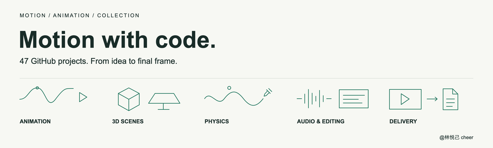

<h1>Awesome Motion & Animation</h1>

22 GitHub projects for animation, 3D, physics, audio, editing, and delivery.

   

<a href="#animation">Explore the collection</a> · <a href="CONTRIBUTING.md">Suggest a resource</a>

A curated collection for developers, motion designers, and creative coders. Find tools by production stage, follow their official repositories, and build a workflow around the piece you want to make.

This collection includes open-source projects and source-available software with custom terms. Free-use eligibility and commercial terms depend on each upstream license.

## 📑 Menu

- [Overview](#overview)
- [Getting started](#getting-started)
- [Workflow](#workflow)
- [Animation & Choreography](#animation)
- [3D & Scenes](#scenes)
- [Physics & Drawing](#physics)
- [Audio & Editing](#audio)
- [Render & Delivery](#delivery)
- [Infographic](#infographic)
- [Licensing](#licensing)
- [Contributing](#contributing)
- [Acknowledgements](#acknowledgements)

## 🧭 Overview
| Category | Projects |
| --- | ---: |
| [Animation & Choreography](#animation) | 6 |
| [3D & Scenes](#scenes) | 5 |
| [Physics & Drawing](#physics) | 4 |
| [Audio & Editing](#audio) | 4 |
| [Render & Delivery](#delivery) | 3 |

## ⚡ Getting started

1. **Choose the output.** Web motion, programmatic video, 3D scenes, and hand-drawn animation call for different starting points.
2. **Pick one core tool.** Explore React video with Remotion, build a 3D scene with Three.js or Babylon.js, or draw animation with OpenToonz.
3. **Add the stages you need.** Bring in physics, voiceovers, subtitles, and mixing as your project requires.
4. **Follow upstream setup and export instructions.** Dependencies, supported platforms, and hardware needs differ between tools.

Use this collection for discovery and tool selection. Choose the pieces you need; there is no requirement to install the entire list.

## 🛠️ Workflow

**Idea → Storyboard → Build → Animate → Mix → Export**

The categories below show where tools can fit into production. Specific combinations depend on formats, dependencies, and your working environment.

## 🎞️ Animation & Choreography

Timelines, keyframes, vector scenes, and data-driven graphics.

### 01 · [Remotion](https://github.com/remotion-dev/remotion)

Make videos programmatically with React.

**License:** [Remotion custom license](https://github.com/remotion-dev/remotion/blob/main/LICENSE.md).

Free use is limited by the upstream eligibility rules; a Company License is required for other organizations.

### 02 · [Anime.js](https://github.com/juliangarnier/anime)

Choreograph JavaScript animations with timelines.

**License:** [MIT](https://github.com/juliangarnier/anime/blob/master/LICENSE.md).

### 03 · [mo.js](https://github.com/mojs/mojs)

Create shape bursts and motion effects.

**License:** [MIT](https://github.com/mojs/mojs/blob/main/LICENSE.md).

### 04 · [Theatre.js](https://github.com/theatre-js/theatre)

Edit animation keyframes visually.

**License:** [Apache-2.0 (core) / AGPL-3.0 (studio)](https://github.com/theatre-js/theatre#license).

The core runtime and visual studio use different licenses; check the component you use.

### 05 · [Two.js](https://github.com/jonobr1/two.js)

Create animated 2D vector scenes.

**License:** [MIT](https://github.com/jonobr1/two.js/blob/dev/LICENSE).

### 06 · [D3](https://github.com/d3/d3)

Build data-driven graphics and visualizations.

**License:** [ISC](https://github.com/d3/d3/blob/main/LICENSE).

## 🧊 3D & Scenes

Build spatial scenes, control cameras, and explore different rendering approaches.

### 07 · [Three.js](https://github.com/mrdoob/three.js)

Build 3D scenes and camera movements.

**License:** [MIT](https://github.com/mrdoob/three.js/blob/dev/LICENSE).

### 08 · [Babylon.js](https://github.com/BabylonJS/Babylon.js)

Build and render real-time 3D scenes.

**License:** [Apache-2.0](https://github.com/BabylonJS/Babylon.js/blob/master/license.md).

### 09 · [Drei](https://github.com/pmndrs/drei)

Use ready-made React Three Fiber helpers.

**License:** [MIT](https://github.com/pmndrs/drei/blob/master/LICENSE).

### 10 · [Spark](https://github.com/sparkjsdev/spark)

Render 3D Gaussian splats with Three.js.

**License:** [MIT](https://github.com/sparkjsdev/spark/blob/main/LICENSE).

### 11 · [cables.gl](https://github.com/cables-gl/cables_electron)

Build node-based visual scenes in the standalone desktop editor.

**License:** [MIT](https://github.com/cables-gl/cables_electron/blob/develop/LICENCE).

## 🌊 Physics & Drawing

Simulate physical motion, write materials, and animate hand-drawn characters.

### 12 · [Taichi](https://github.com/taichi-dev/taichi)

Write high-performance, GPU-accelerated physics simulations.

**License:** [Apache-2.0](https://github.com/taichi-dev/taichi/blob/master/LICENSE).

### 13 · [SPlisHSPlasH](https://github.com/InteractiveComputerGraphics/SPlisHSPlasH)

Simulate SPH fluids and generate foam and spray effects.

**License:** [MIT](https://github.com/InteractiveComputerGraphics/SPlisHSPlasH/blob/master/LICENSE).

### 14 · [Custom Shader Material](https://github.com/FarazzShaikh/THREE-CustomShaderMaterial)

Combine custom shaders with standard Three.js materials and lighting.

**License:** [MIT](https://github.com/FarazzShaikh/THREE-CustomShaderMaterial/blob/main/LICENSE.md).

### 15 · [OpenToonz](https://github.com/opentoonz/opentoonz)

Create hand-drawn 2D character animation.

**License:** [BSD-3-Clause + third-party notices](https://github.com/opentoonz/opentoonz/blob/master/LICENSE.txt).

Third-party libraries and bundled brushes carry their own terms.

## 🎧 Audio & Editing

Add voiceovers, clean up audio, sync subtitles, and automate editing.

### 16 · [Qwen3-TTS](https://github.com/QwenLM/Qwen3-TTS)

Generate expressive speech for voiceovers.

**License:** [Apache-2.0](https://github.com/QwenLM/Qwen3-TTS/blob/main/LICENSE).

### 17 · [Audacity](https://github.com/audacity/audacity)

Record, clean up, edit, and mix audio.

**License:** [GPL-3.0 + file-level notices](https://github.com/audacity/audacity/blob/master/LICENSE.txt).

See the upstream license for file-level and third-party notices.

### 18 · [Subtitle Edit](https://github.com/SubtitleEdit/subtitleedit)

Edit subtitles and adjust their timing.

**License:** [MIT](https://github.com/SubtitleEdit/subtitleedit/blob/main/LICENSE).

### 19 · [Auto-Editor](https://github.com/WyattBlue/auto-editor)

Automatically edit video and audio using silence or loudness analysis.

**License:** [Unlicense](https://github.com/WyattBlue/auto-editor/blob/master/LICENSE).

## 📦 Render & Delivery

Interpolate frames, capture footage, and encode the final output.

### 20 · [RIFE](https://github.com/hzwer/ECCV2022-RIFE)

Interpolate video frames for smoother motion and slow motion.

**License:** [MIT](https://github.com/hzwer/ECCV2022-RIFE/blob/main/LICENSE).

### 21 · [OBS Studio](https://github.com/obsproject/obs-studio)

Capture screens and record video.

**License:** [GPL-2.0-or-later](https://github.com/obsproject/obs-studio/blob/master/COPYING).

### 22 · [FFmpeg](https://github.com/FFmpeg/FFmpeg)

Encode, convert, and package the final video.

**License:** [LGPL-2.1-or-later / optional GPL](https://github.com/FFmpeg/FFmpeg/blob/master/LICENSE.md).

Enabled components and external libraries affect the license of the resulting build.

## 🗺️ Infographic

Open the image for the full-resolution 16:9 version.

## 📄 Licensing

The original curation text and line-art visuals in this repository are licensed under [CC BY 4.0](LICENSE). Attribute **@林悦己 cheer / cheercheung** and indicate changes. This license covers the collection's own content; it does not relicense any linked project.

Each resource includes an upstream license link. Remotion has free-use eligibility conditions; Theatre.js core and studio use different licenses; FFmpeg licensing depends on build components. Check the upstream terms for the version, components, dependencies, model weights, and assets you actually use.

Project sources and license information were checked on **2026-11-02**. Labels are navigation aids; the full upstream terms govern.

## 🤝 Contributing

Start by [reading the contribution guide](CONTRIBUTING.md), or [suggest a project](https://github.com/cheercheung/awesome-motion-animation/issues/new?template=resource.yml). Resource suggestions, clearer descriptions, license corrections, and translation improvements are welcome.

[Read the project data](data/projects.json) · [Read the maintenance guide](docs/maintenance.md)

## 🙏 Acknowledgements

Thanks to the authors, contributors, and maintainers of every upstream project. Development, support, and licensing remain with each project.

[Remotion](https://github.com/remotion-dev/remotion), [Anime.js](https://github.com/juliangarnier/anime), [mo.js](https://github.com/mojs/mojs), [Theatre.js](https://github.com/theatre-js/theatre), [Two.js](https://github.com/jonobr1/two.js), [D3](https://github.com/d3/d3), [Three.js](https://github.com/mrdoob/three.js), [Babylon.js](https://github.com/BabylonJS/Babylon.js), [Drei](https://github.com/pmndrs/drei), [Spark](https://github.com/sparkjsdev/spark), [cables.gl](https://github.com/cables-gl/cables_electron), [Taichi](https://github.com/taichi-dev/taichi), [SPlisHSPlasH](https://github.com/InteractiveComputerGraphics/SPlisHSPlasH), [Custom Shader Material](https://github.com/FarazzShaikh/THREE-CustomShaderMaterial), [OpenToonz](https://github.com/opentoonz/opentoonz), [Qwen3-TTS](https://github.com/QwenLM/Qwen3-TTS), [Audacity](https://github.com/audacity/audacity), [Subtitle Edit](https://github.com/SubtitleEdit/subtitleedit), [Auto-Editor](https://github.com/WyattBlue/auto-editor), [RIFE](https://github.com/hzwer/ECCV2022-RIFE), [OBS Studio](https://github.com/obsproject/obs-studio), [FFmpeg](https://github.com/FFmpeg/FFmpeg).

Curated by **@林悦己 cheer**.
