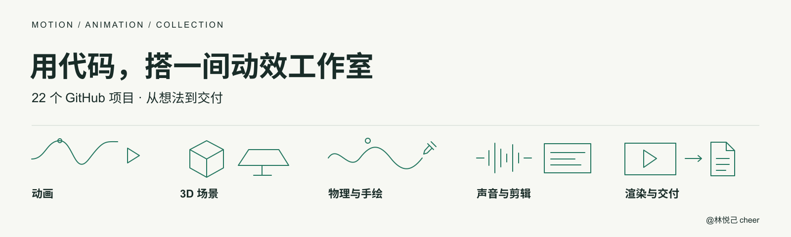
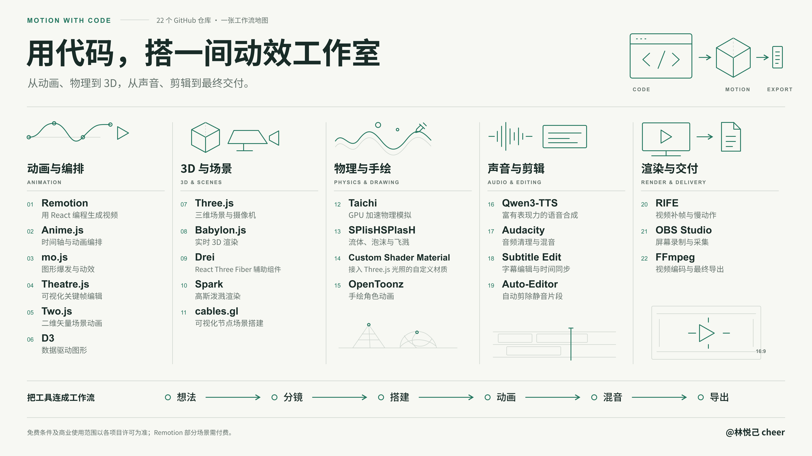

<h1>用代码，搭一间动效工作室</h1>

22 个 GitHub 项目，覆盖动画、3D、物理模拟、声音、剪辑与交付。

<a href="#animation">浏览工具合集</a> · <a href="CONTRIBUTING.md">提交资源建议</a>

这个合集面向开发者、动效设计师与创意编程爱好者，把代码动效和视频制作中的工具按五个环节分类。根据你想完成的作品，找到当前环节需要的项目，再逐步搭建自己的制作流程。

这里收录的是 GitHub 项目与工具，包含开源项目及采用自定义许可的源码可用项目。免费条件和商业使用范围以各项目许可为准。

## 📑 目录

- [合集概览](#overview)
- [从哪里开始](#getting-started)
- [制作流程](#workflow)
- [动画与编排](#animation)
- [3D 与场景](#scenes)
- [物理与手绘](#physics)
- [声音与剪辑](#audio)
- [渲染与交付](#delivery)
- [信息图](#infographic)
- [许可说明](#licensing)
- [参与贡献](#contributing)
- [致谢](#acknowledgements)

## 🧭 合集概览
| 分类 | 项目数 | 主要用途 |
| --- | ---: | --- |
| [动画与编排](#animation) | 6 | 从时间轴、关键帧到矢量场景与数据图形，让画面动起来。 |
| [3D 与场景](#scenes) | 5 | 搭建三维空间，控制摄像机，探索不同的场景渲染方式。 |
| [物理与手绘](#physics) | 4 | 模拟物理运动，编写材质，为手绘角色赋予动作。 |
| [声音与剪辑](#audio) | 4 | 完成配音、音频处理、字幕同步与自动剪辑。 |
| [渲染与交付](#delivery) | 3 | 完成视频补帧、画面采集与最终编码。 |

## ⚡ 从哪里开始

1. **先确定作品形式。** 网页动效、程序化视频、三维场景与手绘动画，适合从不同工具入手。
2. **先选一个核心工具。** 用 Remotion 探索 React 视频，用 Three.js 或 Babylon.js 搭建 3D 场景，或用 OpenToonz 制作手绘动画。
3. **按需要补齐其他环节。** 根据项目需要增加物理模拟、配音、字幕与混音。
4. **按上游文档安装和导出。** 每个工具的依赖、支持平台与资源需求不同，直接阅读对应仓库的入门说明。

合集用于工具发现与选型；你可以按需组合，无须一次安装全部项目。

## 🛠️ 制作流程

**想法 → 分镜 → 搭建 → 动画 → 混音 → 导出**

下面的分类帮助你定位工具在制作中的作用。各项目的具体组合方式取决于格式、依赖与工作环境。

## 🎞️ 动画与编排

从时间轴、关键帧到矢量场景与数据图形，让画面动起来。

### 01 · [Remotion](https://github.com/remotion-dev/remotion)

用 React 编程生成视频。

**上游许可说明:** [Remotion custom license](https://github.com/remotion-dev/remotion/blob/main/LICENSE.md).

免费使用须符合上游资格条件，其他组织需要 Company License。

### 02 · [Anime.js](https://github.com/juliangarnier/anime)

通过时间轴编排 JavaScript 动画。

**上游许可说明:** [MIT](https://github.com/juliangarnier/anime/blob/master/LICENSE.md).

### 03 · [mo.js](https://github.com/mojs/mojs)

制作图形爆发与动态效果。

**上游许可说明:** [MIT](https://github.com/mojs/mojs/blob/main/LICENSE.md).

### 04 · [Theatre.js](https://github.com/theatre-js/theatre)

可视化编辑动画关键帧。

**上游许可说明:** [Apache-2.0 (core) / AGPL-3.0 (studio)](https://github.com/theatre-js/theatre#license).

core 运行时与 studio 可视化编辑器使用不同许可，请按实际组件核对。

### 05 · [Two.js](https://github.com/jonobr1/two.js)

创建二维矢量场景与动画。

**上游许可说明:** [MIT](https://github.com/jonobr1/two.js/blob/dev/LICENSE).

### 06 · [D3](https://github.com/d3/d3)

制作数据驱动的图形与可视化。

**上游许可说明:** [ISC](https://github.com/d3/d3/blob/main/LICENSE).

## 🧊 3D 与场景

搭建三维空间，控制摄像机，探索不同的场景渲染方式。

### 07 · [Three.js](https://github.com/mrdoob/three.js)

创建三维场景与摄像机运动。

**上游许可说明:** [MIT](https://github.com/mrdoob/three.js/blob/dev/LICENSE).

### 08 · [Babylon.js](https://github.com/BabylonJS/Babylon.js)

构建与渲染实时 3D 场景。

**上游许可说明:** [Apache-2.0](https://github.com/BabylonJS/Babylon.js/blob/master/license.md).

### 09 · [Drei](https://github.com/pmndrs/drei)

使用现成的 React Three Fiber 辅助组件。

**上游许可说明:** [MIT](https://github.com/pmndrs/drei/blob/master/LICENSE).

### 10 · [Spark](https://github.com/sparkjsdev/spark)

使用 Three.js 渲染三维高斯泼溅场景。

**上游许可说明:** [MIT](https://github.com/sparkjsdev/spark/blob/main/LICENSE).

### 11 · [cables.gl](https://github.com/cables-gl/cables_electron)

在独立桌面编辑器中通过可视化节点搭建场景。

**上游许可说明:** [MIT](https://github.com/cables-gl/cables_electron/blob/develop/LICENCE).

## 🌊 物理与手绘

模拟物理运动，编写材质，为手绘角色赋予动作。

### 12 · [Taichi](https://github.com/taichi-dev/taichi)

编写高性能、GPU 加速的物理模拟。

**上游许可说明:** [Apache-2.0](https://github.com/taichi-dev/taichi/blob/master/LICENSE).

### 13 · [SPlisHSPlasH](https://github.com/InteractiveComputerGraphics/SPlisHSPlasH)

模拟 SPH 流体并生成泡沫与喷溅效果。

**上游许可说明:** [MIT](https://github.com/InteractiveComputerGraphics/SPlisHSPlasH/blob/master/LICENSE).

### 14 · [Custom Shader Material](https://github.com/FarazzShaikh/THREE-CustomShaderMaterial)

将自定义着色器与 Three.js 标准材质及光照结合。

**上游许可说明:** [MIT](https://github.com/FarazzShaikh/THREE-CustomShaderMaterial/blob/main/LICENSE.md).

### 15 · [OpenToonz](https://github.com/opentoonz/opentoonz)

制作手绘二维角色动画。

**上游许可说明:** [BSD-3-Clause + third-party notices](https://github.com/opentoonz/opentoonz/blob/master/LICENSE.txt).

第三方库与随附笔刷适用各自的许可条款。

## 🎧 声音与剪辑

完成配音、音频处理、字幕同步与自动剪辑。

### 16 · [Qwen3-TTS](https://github.com/QwenLM/Qwen3-TTS)

生成富有表现力的语音，用于配音。

**上游许可说明:** [Apache-2.0](https://github.com/QwenLM/Qwen3-TTS/blob/main/LICENSE).

### 17 · [Audacity](https://github.com/audacity/audacity)

录制、清理、编辑与混合音频。

**上游许可说明:** [GPL-3.0 + file-level notices](https://github.com/audacity/audacity/blob/master/LICENSE.txt).

文件级与第三方组件许可说明以上游文件为准。

### 18 · [Subtitle Edit](https://github.com/SubtitleEdit/subtitleedit)

编辑字幕并调整时间同步。

**上游许可说明:** [MIT](https://github.com/SubtitleEdit/subtitleedit/blob/main/LICENSE).

### 19 · [Auto-Editor](https://github.com/WyattBlue/auto-editor)

根据静音或响度分析自动剪辑视频与音频。

**上游许可说明:** [Unlicense](https://github.com/WyattBlue/auto-editor/blob/master/LICENSE).

## 📦 渲染与交付

完成视频补帧、画面采集与最终编码。

### 20 · [RIFE](https://github.com/hzwer/ECCV2022-RIFE)

通过视频补帧获得更流畅的画面与慢动作效果。

**上游许可说明:** [MIT](https://github.com/hzwer/ECCV2022-RIFE/blob/main/LICENSE).

### 21 · [OBS Studio](https://github.com/obsproject/obs-studio)

采集屏幕并录制视频。

**上游许可说明:** [GPL-2.0-or-later](https://github.com/obsproject/obs-studio/blob/master/COPYING).

### 22 · [FFmpeg](https://github.com/FFmpeg/FFmpeg)

完成视频编码、格式转换与最终封装。

**上游许可说明:** [LGPL-2.1-or-later / optional GPL](https://github.com/FFmpeg/FFmpeg/blob/master/LICENSE.md).

启用的组件与外部库会影响最终构建产物的许可。

## 🗺️ 信息图

点击图片查看 16:9 高清版。

## 📄 许可说明

本仓库的原创整理文案与线条视觉采用 [CC BY 4.0](LICENSE)，引用时请署名 **@林悦己 cheer / cheercheung** 并注明修改。该许可只适用于本合集自己的内容，不会重新许可所链接的第三方项目。

每项资源都附有上游许可链接。Remotion 的免费使用有资格限制；Theatre.js 的 core 与 studio 使用不同许可；FFmpeg 的许可受构建组件影响。请根据实际使用的版本、组件、依赖、模型权重及素材核对上游条款。

项目来源与许可信息核对日期：**2026-11-02**。这些标签用于导航，完整条款以上游文件为准。

## 🤝 参与贡献

通过 [阅读贡献指南](CONTRIBUTING.md) 了解收录要求，或 [提交项目建议](https://github.com/cheercheung/awesome-motion-animation/issues/new?template=resource.yml)。欢迎补充资源、修正用途说明、更新许可信息与改进翻译。

[读取项目数据](data/projects.json) · [查看维护方法](docs/maintenance.md)

## 🙏 致谢

感谢所有上游项目的作者、贡献者与维护者。工具的开发、支持与许可由各自项目负责。

[Remotion](https://github.com/remotion-dev/remotion), [Anime.js](https://github.com/juliangarnier/anime), [mo.js](https://github.com/mojs/mojs), [Theatre.js](https://github.com/theatre-js/theatre), [Two.js](https://github.com/jonobr1/two.js), [D3](https://github.com/d3/d3), [Three.js](https://github.com/mrdoob/three.js), [Babylon.js](https://github.com/BabylonJS/Babylon.js), [Drei](https://github.com/pmndrs/drei), [Spark](https://github.com/sparkjsdev/spark), [cables.gl](https://github.com/cables-gl/cables_electron), [Taichi](https://github.com/taichi-dev/taichi), [SPlisHSPlasH](https://github.com/InteractiveComputerGraphics/SPlisHSPlasH), [Custom Shader Material](https://github.com/FarazzShaikh/THREE-CustomShaderMaterial), [OpenToonz](https://github.com/opentoonz/opentoonz), [Qwen3-TTS](https://github.com/QwenLM/Qwen3-TTS), [Audacity](https://github.com/audacity/audacity), [Subtitle Edit](https://github.com/SubtitleEdit/subtitleedit), [Auto-Editor](https://github.com/WyattBlue/auto-editor), [RIFE](https://github.com/hzwer/ECCV2022-RIFE), [OBS Studio](https://github.com/obsproject/obs-studio), [FFmpeg](https://github.com/FFmpeg/FFmpeg).

整理：**@林悦己 cheer**
